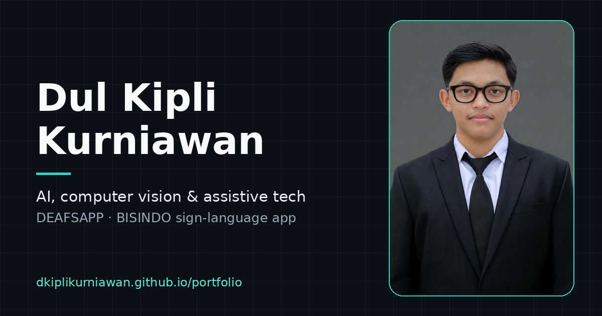
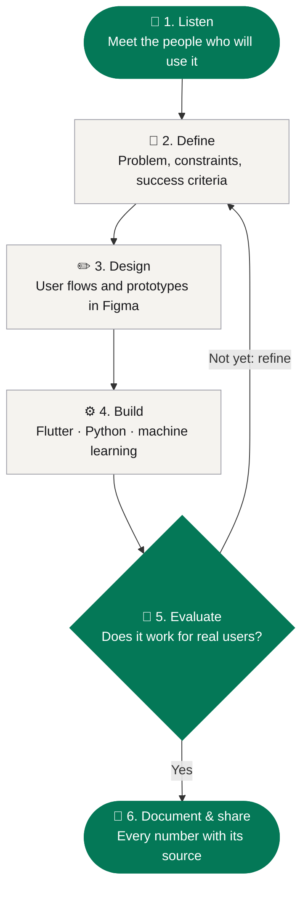
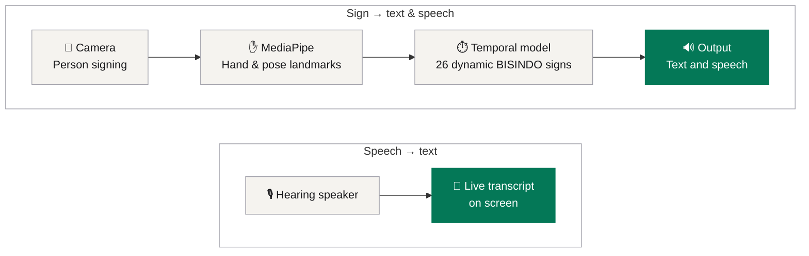
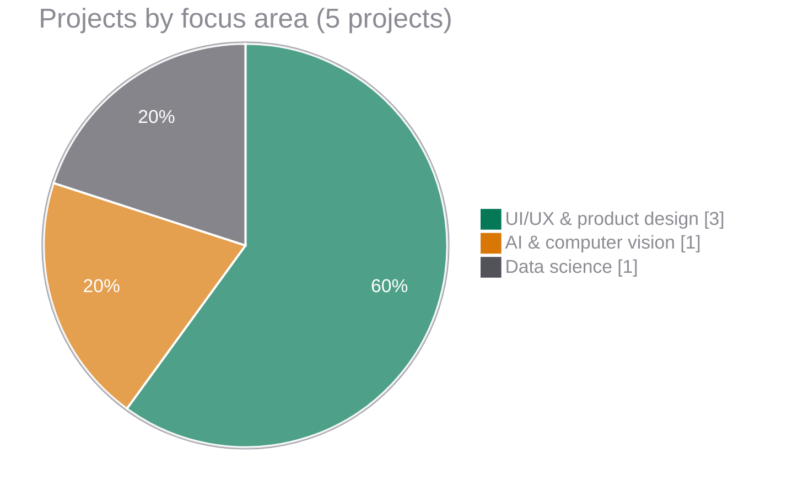
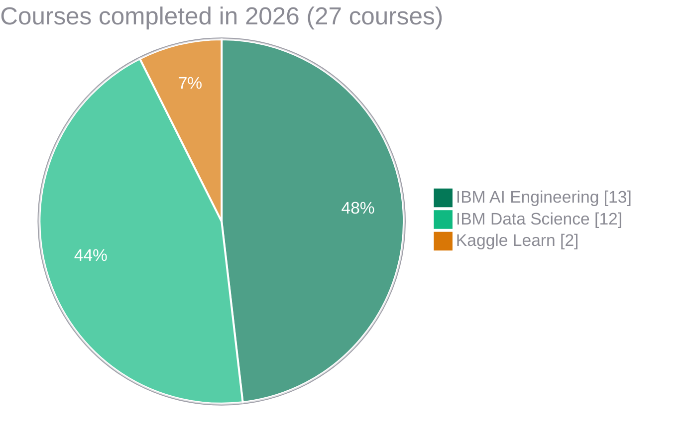
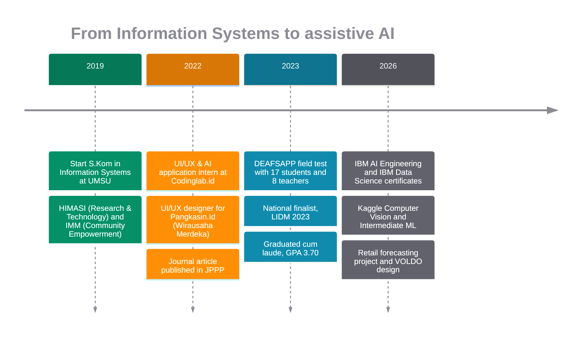
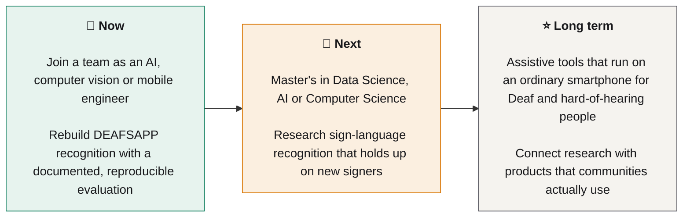

<a href="https://dkiplikurniawan.github.io/portfolio/">
  
</a>

<h1 align="center">Dul Kipli Kurniawan, S.Kom</h1>

<p align="center">
  <b>AI & Assistive Technology Developer</b><br>
  Computer vision and mobile tools for Indonesian Sign Language (BISINDO)
</p>

<p align="center">
  <a href="https://dkiplikurniawan.github.io/portfolio/"></a>
  <a href="https://www.linkedin.com/in/dul-kipli-kurniawan-b82345376"></a>
  <a href="mailto:dkiplikurniawan@gmail.com"></a>
  <a href="assets/CV_DUL%20KIPLI%20KURNIAWAN.pdf"></a>
</p>

---

## 👋 About me

I build assistive technology that works on an ordinary smartphone. My undergraduate thesis project, **DEAFSAPP**, is a Flutter app for learning and communicating in BISINDO. I built it with Deaf students and their teachers at SLB Melati Aisyah in Medan, and it reached the national finals of **LIDM 2023**.

I studied Information Systems at Universitas Muhammadiyah Sumatera Utara (UMSU) and have worked across UI/UX design, Flutter development and AI application development. In 2026 I completed the **IBM AI Engineering** and **IBM Data Science** professional certificates and built a reproducible forecasting project.

The thesis taught me one rule I still follow: **accessible technology is only as good as the evidence behind it.** Every number in this portfolio says where it comes from, and every project says whether it is built, designed or still a concept.

| | |
|---|---|
| 🎓 **Education** | S.Kom, Information Systems, UMSU · Oct 2019 – Aug 2023 · GPA 3.70 / 4.00, *cum laude* |
| 🧭 **Focus** | Computer vision · Sign-language recognition · Mobile apps · Human-centred design |
| 🌏 **Languages** | Indonesian (native) · English (IELTS overall 5.5) |
| 📍 **Based in** | Medan, North Sumatra, Indonesia (UTC+7) |
| 🔎 **Looking for** | AI, computer vision or mobile engineering roles · Master's in Data Science, AI or Computer Science |

---

## 🏆 Highlights

- 🥇 **National Finalist, LIDM 2023.** *Inovasi Teknologi Digital Pendidikan* division, Puspresnas, Kemendikbudristek. Finals held at Universitas Pendidikan Indonesia, 4–6 July 2023.
- ©️ **Registered copyright for DEAFSAPP.** No. EC00202341333, DJKI (2023), co-creator.
- 📜 **IBM AI Engineering** professional certificate, 13 courses ([verify](https://coursera.org/verify/professional-cert/XZCLA29KI5K1)), and **IBM Data Science** professional certificate, 12 courses ([verify](https://coursera.org/verify/professional-cert/BQ4T1C7VB8EC)). Both completed October 2026.
- 🧠 **Kaggle Learn:** [Computer Vision](https://www.kaggle.com/learn/certification/dulkiplikurniawannn/computer-vision) and [Intermediate Machine Learning](https://www.kaggle.com/learn/certification/dulkiplikurniawannn/intermediate-machine-learning), September 2026.
- 📝 **Journal article (2022), sole author:** online game addiction in adolescents and parental anxiety, *JPPP* 3(2). [doi.org/10.30596/jppp.v3i2.10835](https://doi.org/10.30596/jppp.v3i2.10835)
- 🎤 **3rd place**, University Logic Debate Competition, UMSU (2022).

---

## 🔄 How I work

I use the same loop on every project, from field research to a documented result. Nothing ships until it has been tested with the people it is for.



### Example: the DEAFSAPP pipeline

This is how the thesis-stage system turns signing into text and speech, and speech into text, without gloves or sensors.



> Reported in the 2023 thesis: **76.1% recognition accuracy** on 26 dynamic sign sequences, and a **usability score of 76.5** (instrument still being confirmed). Field test: **17 students and 8 teachers** at one school. The evaluation data is not public, and the test split and signer independence are undocumented, so these figures do not measure performance on new signers. The surviving V1 Flutter code is public at [DEAFSAPP-V1](https://github.com/dkiplikurniawan/DEAFSAPP-V1).

---

## 🗂️ Selected work

| # | Project | What it is | Status | Links |
|---|---|---|---|---|
| ★ | **DEAFSAPP** | Flutter app for BISINDO learning and communication, with gesture recognition and speech-to-text | Research prototype (thesis, 2022–2023) | [Case study](https://dkiplikurniawan.github.io/portfolio/deafsapp.html) · [V1 code](https://github.com/dkiplikurniawan/DEAFSAPP-V1) |
| 1.0 | **Retail Demand Forecasting & Planning Buffers** | 12-month forecasts for 110 Australian retail series (ABS, 1982–2018). ETS cut mean MASE from 1.21 to 1.06 against a seasonal-naive baseline; error-based buffers covered 82% of months against a 90% target | Completed first version | [Results](https://dkiplikurniawan.github.io/portfolio/projects/retail-demand-forecasting/) · [Code](projects/retail-demand-forecasting) |
| 2.0 | **VOLDO** *(formerly SUCARE)* | Volunteer and social-impact app: 80+ Figma screens for three roles plus an admin panel | Design in progress | [Screens](https://dkiplikurniawan.github.io/portfolio/#voldo) |
| 3.0 | **SPASI** *(formerly RUANGI·JO)* | Café-based productivity and community platform: brand identity, mobile UI and a product blueprint with MoSCoW requirements | Conceptual case study | [Portfolio](https://dkiplikurniawan.github.io/portfolio/#work) |
| 4.0 | **Pangkasin.Id** | Barber-booking app for a student startup under Wirausaha Merdeka: user research, wireframes, prototypes | Completed design work, 2022 | [Portfolio](https://dkiplikurniawan.github.io/portfolio/#work) |

### Portfolio at a glance





---

## 🛠️ Tech & design stack

| Area | Tools |
|---|---|
| **Software engineering** |        |
| **AI & data** |        |
| **Design** |   User research · Usability testing · PRD & MoSCoW · WCAG-informed design |

*"Coursework" marks skills practised in certificate labs, not yet in a shipped project.*

---

## 🧭 My journey



---

## 🚀 Goals



---

## 📬 Let's talk

I'm open to full-time roles, freelance UI/UX and app development, research collaboration, and master's programme enquiries.

- 🌐 **Portfolio:** [dkiplikurniawan.github.io/portfolio](https://dkiplikurniawan.github.io/portfolio/)
- ✉️ **Email:** [dkiplikurniawan@gmail.com](mailto:dkiplikurniawan@gmail.com)
- 💼 **LinkedIn:** [Dul Kipli Kurniawan](https://www.linkedin.com/in/dul-kipli-kurniawan-b82345376)
- 🐙 **GitHub:** [@dkiplikurniawan](https://github.com/dkiplikurniawan)

---

<details>
<summary><b>⚙️ About this repository (technical notes)</b></summary>

<br>

This repository is the source of the portfolio site, published with GitHub Pages from the `main` branch root.

### Structure

| Path | What it is |
|---|---|
| `index.html` | Home page (hero, about, DEAFSAPP, VOLDO, work, experience, skills, contact) |
| `deafsapp.html` | DEAFSAPP case study with evidence-tagged architecture and evaluation audit |
| `projects/retail-demand-forecasting/` | Data science project: code, notebook, README, generated results page |
| `style.css` | Design tokens and the styles Tailwind utilities don't cover |
| `script.js` | Motion system, navigation, skills tabs, contact form |
| `assets/case-study.css` | Shared plain-CSS styles for case-study pages |
| `assets/` | CV, certificates, images, favicon, social-sharing image |
| `404.html`, `sitemap.xml` | Not-found page and sitemap |

No build step: the home page uses the Tailwind Play CDN, and case-study pages use plain CSS.

### Preview locally

```bash
python -m http.server 8000
# open http://localhost:8000/
```

Open the site through a local server rather than by double-clicking the file, so relative links behave as on GitHub Pages.

### Publish

```bash
git add -A
git commit -m "Update portfolio"
git push origin main
```

### Motion system

Layout and scroll feel are modelled on editorial sites such as Lenval Properties. The site uses the same open-source stack, loaded from jsDelivr with pinned versions:

- **GSAP 3.15.0** with **ScrollTrigger** and **SplitText**: reveals, scroll-scrubbed effects, 3D phones.
- **Lenis 1.3.21**: smooth scrolling.

| Effect | Markup hook | Function in `script.js` |
|---|---|---|
| Intro: lens and name traced in outline, then filled (Ownitt-inspired), once per session, Skip button / Esc | `.curtain` | `initIntro()` |
| Hero entrance: "Hello." by character, photo clip reveal | `[data-hero]` | `initIntro()` |
| Heading line reveal | `data-split-lines` | `initTextReveals()` |
| Words brighten while scrolling | `data-scrub-words` | `initTextReveals()` |
| About photo opens to full bleed with parallax (NY Phil-inspired split) | `data-about-photo` | `initAboutPhoto()` |
| Number reels roll from 0 to the value | `.odo[data-count]` | `initOdometers()` |
| Fade-up blocks (staggered, once) | `data-fade` | `initTextReveals()` |
| DEAFSAPP stages and a field-photo stack that wipes up as you read (Bright Avenue-inspired); carousel on phones | `#pipeline .stage[data-stage]`, `[data-gallery] .g-slide` | `initPipeline()` |
| VOLDO 3D phones fan out, pointer tilt | `data-phones` | `initPhones()` |
| Image preview following the cursor on work rows | `.work-row[data-preview]` | `initWorkPreview()` |
| Magnetic primary buttons (max 6 px) | `data-magnetic` | `initMagnetic()` |
| Skills tabs (ARIA tabs) | `[data-tabs]` | `initTabs()` |

Fallbacks:

- **No JavaScript:** everything is visible as static HTML, including all four skill panels.
- **CDN unreachable:** the page renders statically and the pipeline still works.
- **`script.js` fails:** a failsafe shows all content after 2.5 s.
- **`prefers-reduced-motion`:** no curtain, no smooth scroll, no tweens.

### Content rules

- Every metric on the site must have a source. DEAFSAPP thesis results are labelled "reported" because the evaluation data is not public.
- Project status labels: Completed, In progress, Research prototype, Conceptual case study.
- Portrait: `assets/profile-480.webp` / `profile-800.webp`; header avatar `assets/avatar-72.webp`.
- DEAFSAPP field photos: `assets/deafsapp-field-{1..5}-{640,1100}.webp`.
- The CV link points to `assets/CV_DUL KIPLI KURNIAWAN.pdf` (the latest CV).

### Contact form

Messages are delivered by [Web3Forms](https://web3forms.com) to `dkiplikurniawan@gmail.com` (`FORM_ENDPOINT` and `FORM_ACCESS_KEY` in `script.js`). The access key is public by design: it can only send to the inbox it was created for. The service answers with JSON, so the page shows **Message sent** only when delivery is confirmed. Otherwise the visitor gets an error with a ready-made email link and keeps their text.

No activation step is needed. To change the receiving inbox, create a new access key at web3forms.com with that address and replace `FORM_ACCESS_KEY`.

FormSubmit was used before, but `formsubmit.co` did not respond from Indonesian connections during testing (October 2026), so it was replaced.

The send button animates: the paper plane flies off, the button becomes a spinner, then a check mark. A success panel replaces the form, with **Send another message** to reset.

</details>

<p align="center"><sub>© 2026 Dul Kipli Kurniawan · Built with care, tested for accessibility, every number sourced.</sub></p>
